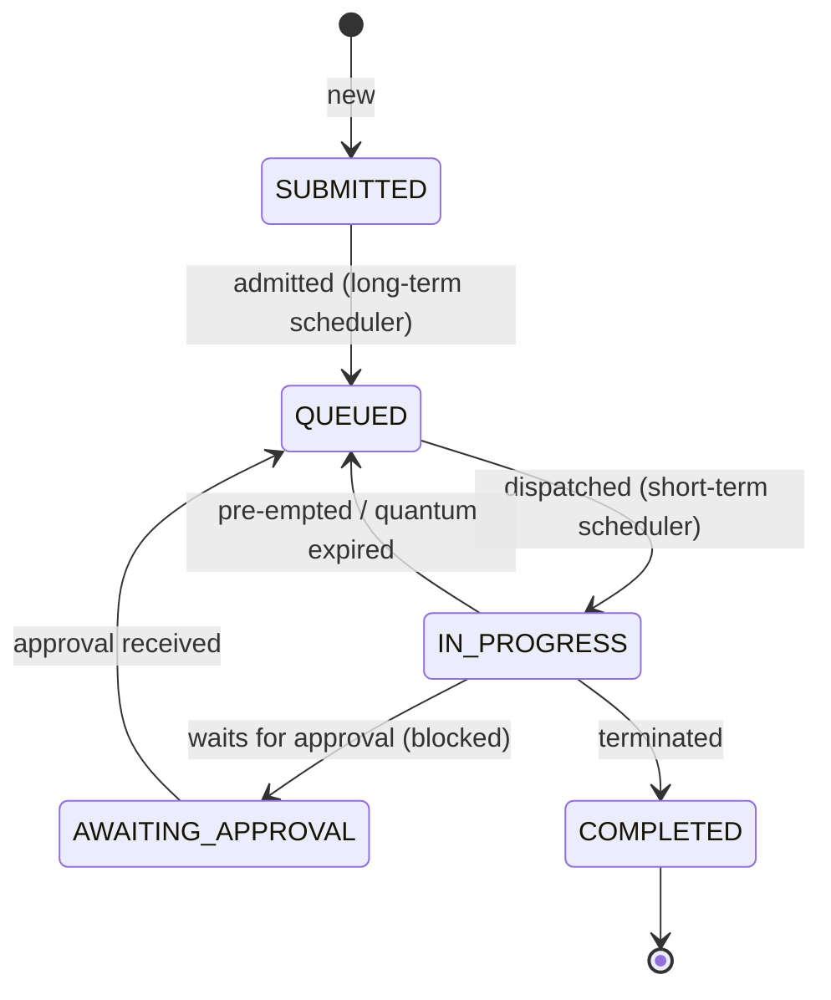

# Architecture

## Overview

```
                    ┌──────────────── Scheduling simulation (Unit 2) ────────────────┐
intake.py (CSV) ──> ContractRequest (PCB) ──> WorkflowEngine <──> DispatchPolicy
estimation.py ────> estimated effort            │  long-term: admission limit / job pool
                                                │  short-term: policy.pick_next()
                                                │  dispatcher: switch + audit
                                     lifecycle.py (state rules + audit trail)
                                                │
                         analytics.py ──> report.py (text) / html_report.py (Gantt)

                    ┌──────────── Concurrent server (Unit 3) ────────────┐
intake threads ──put──> BoundedRequestQueue ──get──> worker threads
 (producers)            (semaphores + mutex)          (consumers)
                                                          │ session limit (counting semaphore)
                                                          ▼
                                       ContractStore (readers-writers lock per contract)

deadlock.py: Banker's Algorithm · wait-for graph · recovery · OrderedLocks
scripts/   : due-date reminders · archival · system info · admin menu
```

## Request Lifecycle (process states)



All changes go through `change_status()`, which rejects illegal moves (for
example Queued straight to Completed) and records time, request, old and new
status, and a note such as "time quantum expired" or "paused for a shorter request".

## Contract Request (PCB)

| Field | PCB role |
|---|---|
| request_id | process id |
| status | process state |
| priority | scheduling priority |
| submitted_at, effort, due_at | arrival, burst, deadline |
| estimated_effort | predicted burst used by SJF/SRTF |
| remaining_effort, work_done | remaining time, progress ("program counter") |
| contract_id | resource held |
| started_at, completed_at | recorded during handling |
| queue_wait, total_handling_time, first_response_delay, sla_breached | waiting, turnaround, response, deadline miss |

## Dispatch Policy Interface

A policy implements `pick_next(queue, active, now)` and, if it keeps state
between calls (time slices, MLFQ levels), `reset()`. The engine consults the
policy every minute, so pre-emptive and non-preemptive policies plug in
without changing the engine. `TimeSlice` in `policies/base.py` is shared by
Round Robin, MLQ and MLFQ.

| Policy | Pre-emptive | Selection |
|---|---|---|
| FCFS | no | earliest arrival |
| SJF | no | smallest estimated effort |
| SRTF | yes | smallest estimated remaining effort |
| Round Robin | yes (quantum) | head of FIFO queue |
| MLQ | yes | fixed queue by priority, RR within Urgent/Standard, FCFS in Background |
| MLFQ | yes | all start Urgent; demote on full quantum, promote after waiting (aging) |
| EDF | yes | earliest due time |

## Concurrency Design

- **Semaphores** are written as monitors (lock + condition variable) with a
  FIFO wait queue. A plain condition-variable semaphore lets a busy thread
  re-take the permit ahead of sleeping threads; the FIFO queue gives bounded
  waiting, so work spreads across all worker threads.
- **One readers-writers lock per contract**: views of different contracts and
  concurrent views of the same contract proceed in parallel; an edit has its
  contract to itself.
- **Instrumentation** (occupancy counters behind a separate probe lock) lets
  tests prove that no rule was broken rather than trusting the output.

## Design Decisions

- **Minute-by-minute simulation** keeps pre-emption logic simple and verifiable.
- **Input is copied** so one request set can be run under several policies.
- **Due-date validation** rejects requests that can never be finished in time.
- **Tests use hand-calculated waits** (textbook examples and a traced SRTF run),
  so results can be verified independently.
- **Standard library only** for the code; pytest is the only extra dependency.
