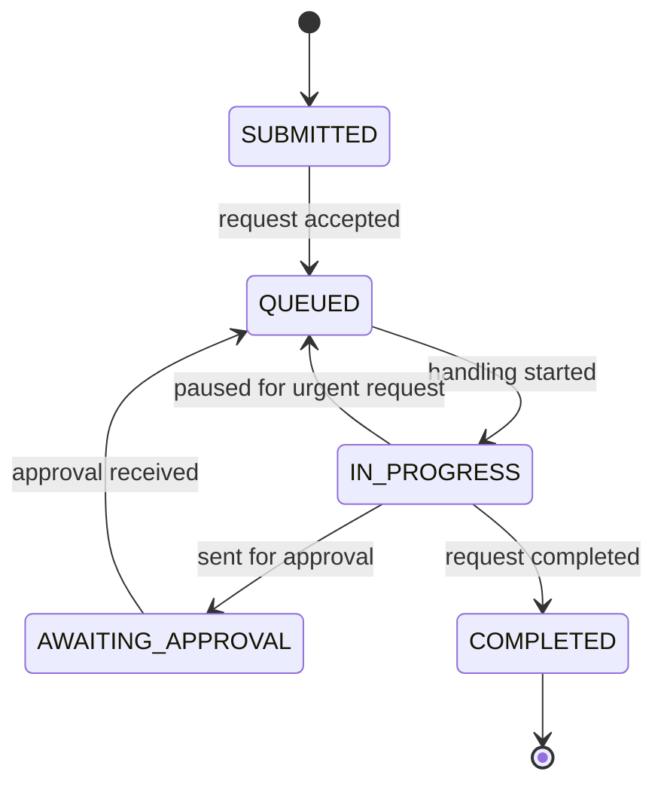

# Architecture

## Overview

```
intake.py (CSV) -> ContractRequest objects -> WorkflowEngine <-> DispatchPolicy
                                                   |
                                     lifecycle.py (status rules + audit trail)
                                                   |
                                     analytics.py -> report.py -> CLI output
```

## Request Lifecycle



All changes go through `change_status()`, which rejects illegal moves (for
example Queued straight to Completed) and records time, request, old and new
status, and a note.

## Contract Request

| Field | Purpose |
|---|---|
| request_id, contract_id, request_type | Identity |
| submitted_at, effort, due_at, priority | Inputs |
| remaining_effort, status | Runtime state |
| started_at, completed_at | Recorded during handling |
| queue_wait, total_handling_time, first_response_delay, sla_breached | Derived measures |

## Dispatch Policy Interface

A policy implements `pick_next(queue, active, now)` and declares whether it may
interrupt the active request. The engine consults it every minute, so new
policies plug in without changing the engine.

## Design Decisions

- **Minute-by-minute simulation** keeps interruption logic simple and verifiable.
- **Input is copied** so one request set can be run under several policies.
- **Due-date validation** rejects requests that can never be finished in time.
- **Tests use hand-calculated waits**, so results can be verified independently.
